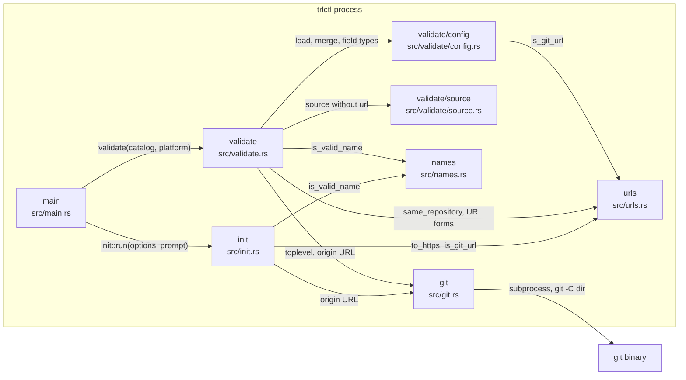

# Architecture

## Overview

`trlctl` is a one-shot command-line tool with two commands, both run on local
checkouts of a layout that follows the
[therealm Argo CD layout specification](https://github.com/therealm-tech/layout-spec/blob/main/SPEC.md):
`init` writes a layout's skeleton, `validate` reads a layout and reports what
breaks the specification. It works offline and holds no state between runs. It
does not render the layout into Argo CD objects, talk to Argo CD or a cluster,
or fetch the repositories a `cluster.yaml` names. The commands and their flags
are in the [README](README.md#getting-started).

The crate is a library ([`src/lib.rs`](src/lib.rs)) and a binary
([`src/main.rs`](src/main.rs)) on top of it, so the integration tests call
`validate` directly and run the binary only where the command line is what
they test.

## Components

- **[`src/main.rs`](src/main.rs)** — the command line: flags and their
  environment variables, logging to stderr, the human and JSON output of the
  findings, and the exit status. It implements the `Prompt` that `init` asks
  missing values through, on the terminal, and fails when stdin is not one. It
  holds no rule of the specification.
- **[`src/init.rs`](src/init.rs)** — scaffolding. It resolves the cluster name
  and the two repository URLs from the options, the `origin` remote and the
  prompt, renders `cluster.yaml`, and creates `apps/`, `envs/`,
  `clusters/<cluster>/apps/` and `clusters/<cluster>/envs/` with a `.gitkeep`
  when they are empty. It returns the files it wrote; `main` prints them.
- **[`src/validate.rs`](src/validate.rs)** — the walk over both layout roots.
  It loads each configuration level, builds every instance's effective
  configuration, checks names, `cluster.yaml` and the instance directories, and
  collects the findings. A finding is a file, a severity, an optional section
  and a message; the findings are kept in a sorted set, so the output is
  deterministic and a problem reached from several instances is reported once.
- **[`src/validate/config.rs`](src/validate/config.rs)** — the configuration
  files: loading YAML (missing, unparsable or parsed), the shape and field
  types of an `app.yaml` (SPEC.md §8.1), the override of one level by the next
  (§10.2), and the repositories a `cluster.yaml` names (§9).
- **[`src/validate/source.rs`](src/validate/source.rs)** — the sources the
  repo catalogue holds: the form of a `path` without `url`, whether it exists,
  no `Chart.yaml` under `manifests/`, and every reference out of the source —
  kustomization entries, `file://` chart dependencies, Jsonnet imports —
  staying within its app directory (§8.2, §8.3).
- **[`src/urls.rs`](src/urls.rs)** — URL forms: a Git repository URL, a Helm
  chart repository or OCI registry, the `https://` form of a remote, and the
  normalised form two URLs of one repository share.
- **[`src/names.rs`](src/names.rs)** — the lowercase DNS label every app, env,
  cluster and instance name must be (§5).
- **[`src/git.rs`](src/git.rs)** — two read-only queries, the `origin` URL and
  the top-level directory of the checkout holding a directory, through the
  `git` binary. Any failure, `git` missing included, is an absent answer.

## Data flow

### `init`

`init` resolves every value before it writes anything. The cluster name comes
from `--cluster` or the prompt, and must be a valid name. With both roles, the
catalogue URL comes from `--catalog-url`, else the `origin` remote, else the
prompt, and the platform URL defaults to the catalogue URL. With
`--platform-only`, the platform URL comes from `--platform-url`, else `origin`,
else the prompt, and the catalogue URL from `--catalog-url` or the prompt only:
the repository being initialised is not the catalogue. `origin` is converted
to its `https://` form, both URLs must be Git URLs, and an existing
`cluster.yaml` stops the command unless `--force` is set. Only then are the
directories and `cluster.yaml` written. `--catalog-only` asks for nothing and
creates `apps/` alone.

### `validate`

`validate` takes the layout root of the repo catalogue and that of the repo
platform, and reads them in this order:

1. **The catalogue**: each `apps/<app>/` holding an `app.yaml` is an app, whose
   `app.yaml` sets exactly one of `chart` and `path`.
2. **The env level**: `envs/<env>/<app>/app.yaml`.
3. **Each cluster**, `clusters/<cluster>/`: its `cluster.yaml`, its cluster×app
   level `clusters/<cluster>/apps/<app>/app.yaml`, then each instance
   `clusters/<cluster>/envs/<env>/<app>/<instance>/app.yaml`.

Only `apps/` and `envs/` are read under `clusters/<cluster>/`. Another
directory there is ignored, with a warning when it holds instances or a
cluster×app `app.yaml` or `values.yaml`, since nothing in it gets deployed. An
`app.yaml` or a `values.yaml` in `clusters/<cluster>/envs/<env>/<app>/` gets
the same warning: no configuration level sits between the env and the
instance.

For each instance, the effective configuration is the catalogue `app.yaml`,
overridden by `envs/<env>/<app>/app.yaml`, then by
`clusters/<cluster>/apps/<app>/app.yaml`, then by the instance's own
`app.yaml`; mappings combine key by key and a null value is not set.
`check_effective` then checks the combination of `chart`, `path`, `url` and
`revision`. A source with `path` and no `url` lives in the repo catalogue, so
it is checked there by [`src/validate/source.rs`](src/validate/source.rs).

`repo.platform` in each `cluster.yaml` must designate the checkout holding it.
That is checked only when the platform root is inside a Git checkout: the
declared path must be the layout root's path inside the checkout. The URL is
compared only when the checkout has an `origin` remote.

The sorted findings go back to `main`, which prints them and sets the exit
status.

## Design decisions

**Errors and warnings.** An error is a rule of the specification broken, and
always names its section. A warning is something the specification allows but
that is likely a mistake or that Argo CD will fail on: a source path that does
not exist, a misplaced directory, a `repo.platform.url` that is not `origin`.
Warnings never change the exit status, so a layout the specification accepts
never fails a pipeline on a heuristic.

**Exit statuses.** `1` is reserved for a layout with violations; `2` means the
tool could not do its job — bad usage, an unreadable file, `init` refusing to
write. A pipeline can tell "the change is wrong" from "the check did not run".

**Git as a subprocess, and optional.** Two read-only queries do not justify a
Git library in the dependency tree and in the static binaries, and the
subprocess sees the repository as the user's own `git` does. Without `git`, or
outside a checkout, `init` needs its URLs from the flags or the prompt, and
`validate` skips the `repo.platform` comparison; nothing else depends on it.

**Two layout roots.** The specification lets the repo catalogue and the repo
platform live in one repository or in two. `validate` takes both roots, which
default to the same directory, and `init` creates either role or both, so one
code path serves both arrangements.

**Normalised URLs, and which mismatch is an error.** URLs are compared once
reduced to host and path, lowercased, whatever the transport, credentials,
port or `.git` suffix: `git@host:org/repo.git` and `https://host/org/repo`
designate the same repository. A `repo.platform.url` that differs from
`origin` is only a warning, because a fork or a mirror validates with its own
`origin`. A `repo.platform.path` that differs from the layout root is an error:
the path inside the repository is the same in every clone.

**Offline only.** `validate` reads nothing but the two checkouts, so it is
deterministic, needs no credentials and runs anywhere a pull request runs. The
price is in [Limitations](#limitations).

## Invariants

- **`validate` never writes**, to the layouts or anywhere else.
- **`init` writes only under `--dir`**, resolves and checks every value before
  its first write, and refuses to overwrite an existing `cluster.yaml` without
  `--force`. A directory that already holds files gets no `.gitkeep`.
- **Every finding names a file relative to its layout root**, the catalogue's
  or the platform's, and **every error names a section** of the specification
  (`§8.2`). A warning names one only when it relates to one.
- **A file that does not parse is a finding; a file that cannot be read is a
  failure** of the tool, with exit status `2`.

## Limitations

- **The content of `values.yaml` files is not analysed**: only where they sit.
- **Sources with a `url` are not checked**: the chart, the repository or the
  path they designate lives outside the checkouts, and `trlctl` does not fetch.
- **Nothing is rendered**, so an error Helm, Kustomize or Jsonnet would raise
  while rendering a source that passes the checks is out of reach.
